# Elasticsearch Repository vs JPA Repository: Concepts and Internals

A guide to what `ElasticsearchRepository<UserDocument, String>` and `JpaRepository<User, Long>` actually do at runtime, how the two data stores work inside, and how to combine them in a microservice.

Diagrams use [Mermaid](https://mermaid.js.org/), which GitHub, GitLab, IntelliJ and VS Code (with a plugin) render automatically.

## Contents

1. [The big picture](#1-the-big-picture)
2. [Same interfaces, different engines](#2-same-interfaces-different-engines)
3. [What Spring does when your app starts](#3-what-spring-does-when-your-app-starts)
4. [Under the hood: JPA and the relational database](#4-under-the-hood-jpa-and-the-relational-database)
5. [Under the hood: Elasticsearch](#5-under-the-hood-elasticsearch)
6. [Mapping a class: `@Entity` vs `@Document`](#6-mapping-a-class-entity-vs-document)
7. [Writing queries](#7-writing-queries)
8. [Consistency, transactions and refresh](#8-consistency-transactions-and-refresh)
9. [Using both: the sync architecture](#9-using-both-the-sync-architecture)
10. [Failure modes and how to handle them](#10-failure-modes-and-how-to-handle-them)
11. [When to use which](#11-when-to-use-which)
12. [Common pitfalls](#12-common-pitfalls)
13. [Glossary](#13-glossary)

---

## 1. The big picture

| | JPA repository | Elasticsearch repository |
|---|---|---|
| **Question it answers** | "What is the exact current state of this record?" | "Which records best match this text?" |
| **Role** | System of record (source of truth) | Search index (a derived, rebuildable copy) |
| **Data structure** | B-tree indexes over rows in tables | Inverted index over documents (Lucene) |
| **Strength** | Correctness, relations, transactions | Relevance, full-text, fuzziness, speed on text |
| **Weakness** | Poor at ranked free-text search | No joins, no ACID, eventually consistent |

Rule of thumb: **write the truth to SQL, search a copy in Elasticsearch.**

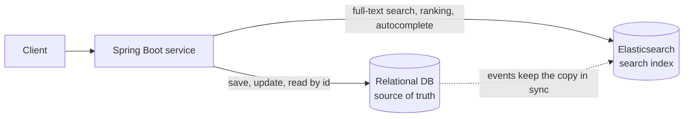

---

## 2. Same interfaces, different engines

Both repositories sit on the same Spring Data base interfaces, which is why `save()`, `findById()`, `deleteById()` and paging look alike. Everything below those interfaces is different.

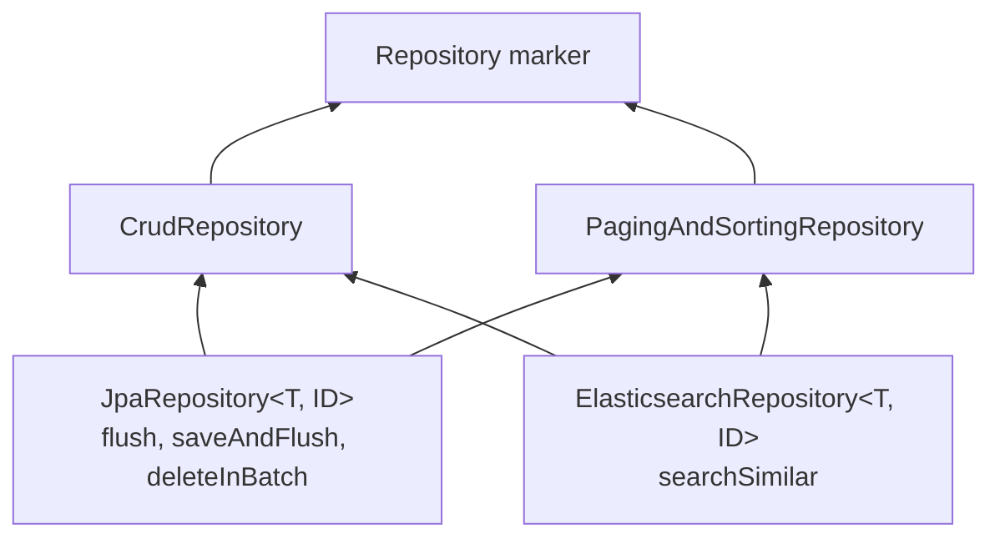

The exact parent interfaces (for example the `List...` variants) differ slightly between Spring Data versions, but the idea is the same: a shared CRUD contract with store-specific additions.

What you inherit:

| Method idea | JPA behaviour | Elasticsearch behaviour |
|---|---|---|
| `save(entity)` | `persist` if new, otherwise `merge`; SQL runs at flush or commit | Sends an index request, which **replaces the whole document** with that ID |
| `findById(id)` | Primary-key lookup (checks the persistence context first) | GET by document ID (real-time, bypasses the refresh delay) |
| `findAll(pageable)` | `SELECT ... LIMIT/OFFSET` | `search` with `from` and `size` (limited depth, see pitfalls) |
| `deleteById(id)` | `DELETE FROM ... WHERE id = ?` | Marks the document deleted; space is reclaimed later at segment merge |
| `count()` | `SELECT COUNT(*)` | `_count` API (counts documents visible to search) |
| Derived queries | `findByLastName` becomes SQL | `findByLastName` becomes a `match`/`term` query |

---

## 3. What Spring does when your app starts

You only write an interface. Spring generates the implementation at startup.

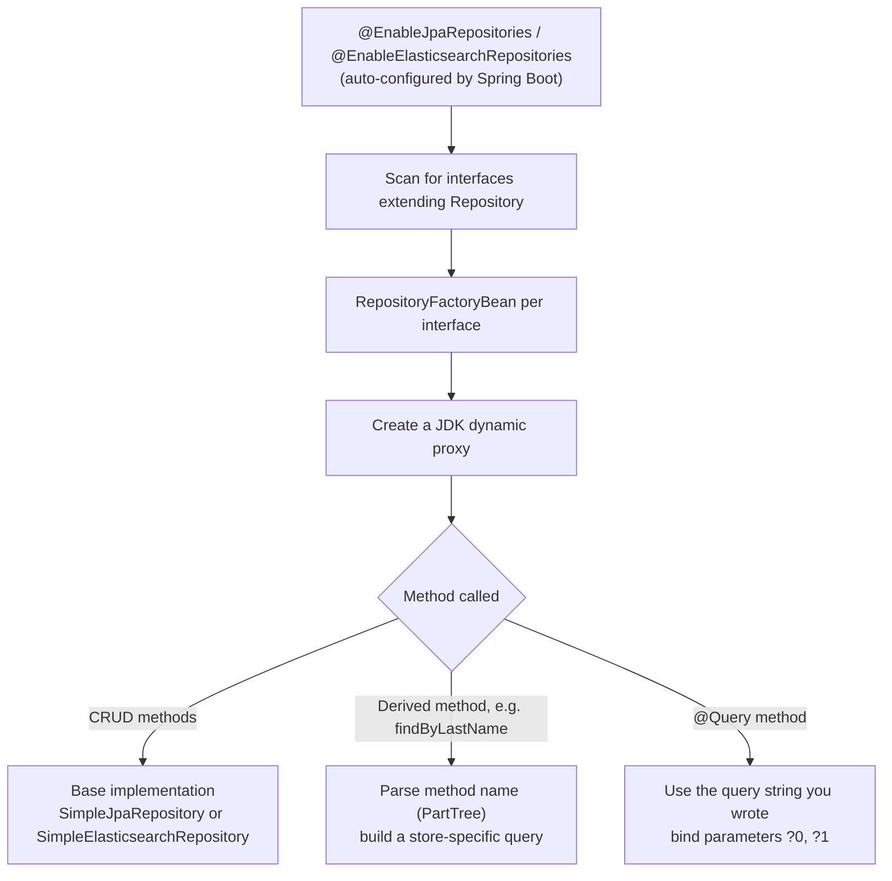

Call path at runtime:

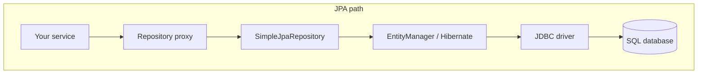

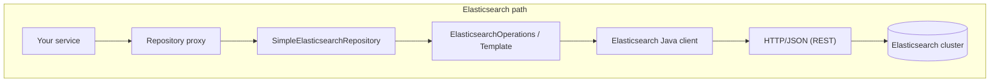

Important consequence: a JPA call goes through a **stateful session** with caching and dirty checking, while an Elasticsearch call is a **stateless HTTP request** every time.

---

## 4. Under the hood: JPA and the relational database

### 4.1 The persistence context

`EntityManager` (Hibernate `Session`) keeps a first-level cache of every entity it loaded or saved during the current transaction.

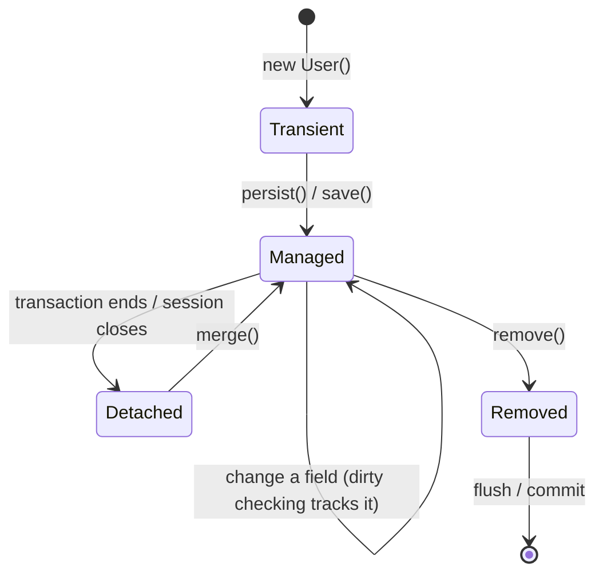

- **Dirty checking:** you can change a managed entity's field and never call `save()`. At flush, Hibernate compares the entity with its loaded snapshot and writes an `UPDATE` automatically.
- **Flush:** the moment Hibernate sends the pending SQL. It happens before a query that could be affected, and at commit.
- **First-level cache:** asking for the same ID twice in one transaction hits the database once.

### 4.2 What happens on `userRepository.save(user)`

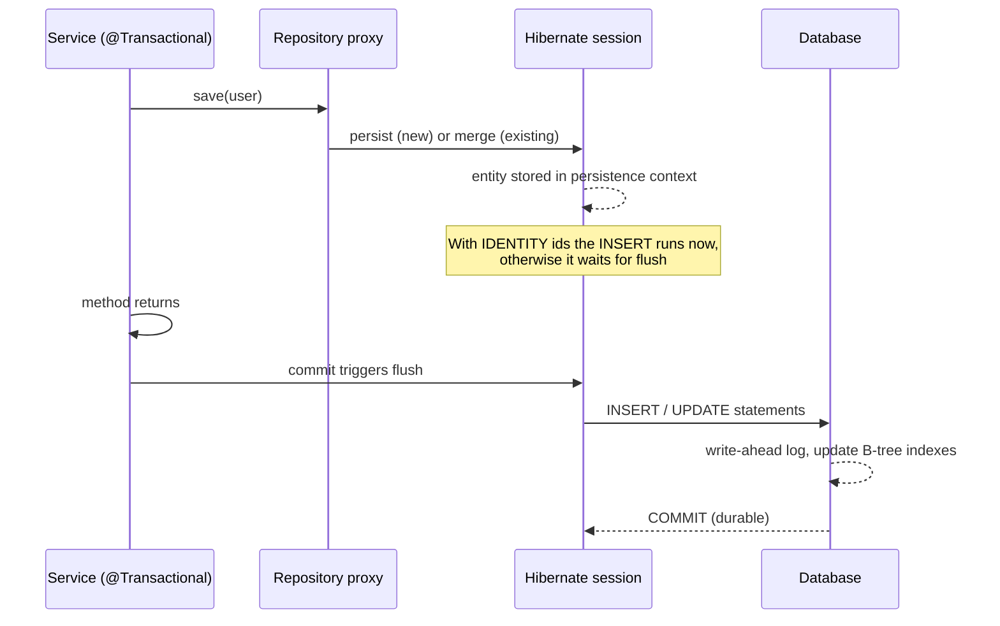

### 4.3 Inside the database

- **Tables and B-tree indexes:** rows are located by index lookups. A `LIKE 'abc%'` can use an index, but `LIKE '%abc%'` usually cannot, which is why SQL is weak at free-text search.
- **ACID:**
    - Atomicity: all statements commit or none do.
    - Consistency: constraints (foreign keys, unique) always hold.
    - Isolation: concurrent transactions do not see each other's half-finished work (usually through MVCC).
    - Durability: committed data survives a crash (write-ahead log).
- **Joins:** the database combines tables at query time. This is cheap in SQL and very expensive or impossible in Elasticsearch.
- **Read-after-write:** once a transaction commits, any later read sees the change.

---

## 5. Under the hood: Elasticsearch

### 5.1 Cluster layout

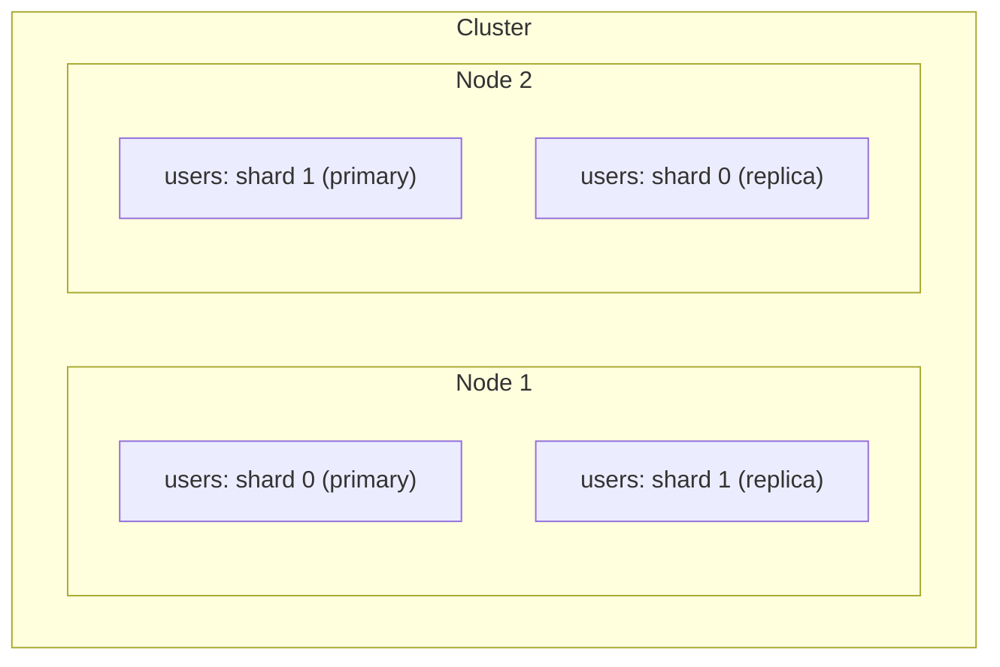

- **Index:** a named collection of documents (like a table, but schema-flexible). Example: `users`.
- **Document:** one JSON object (your `UserDocument`).
- **Shard:** an index is split into shards. Each shard is a complete **Lucene** index. A document is routed to a shard by hashing its ID.
- **Replica:** a copy of a primary shard on another node, for failover and extra read capacity.
- **Node:** one running Elasticsearch process.

### 5.2 The inverted index

A relational index maps **row to value**. An inverted index maps **word to the documents that contain it**, which is what makes text search fast.

```text
Documents                                   Inverted index (after analysis)
---------                                   ------------------------------
1: "Senior Java Engineer"                    java      -> [1, 3]
2: "Data Engineer, Colombo"                  senior    -> [1]
3: "Java Developer, Colombo"                 engineer  -> [1, 2]
                                             data      -> [2]
Query: "java colombo"                        developer -> [3]
  java    -> [1, 3]                          colombo   -> [2, 3]
  colombo -> [2, 3]
  doc 3 matches both terms -> highest score
```

### 5.3 Analysis: how text becomes terms

When a `text` field is indexed, an **analyzer** processes it:

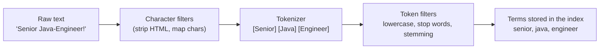

The **same analyzer** processes your search text, so "JAVA" finds "java".

| Field type | Analyzed? | Use for |
|---|---|---|
| `Text` | Yes, split into terms | Full-text search (names, headline, description) |
| `Keyword` | No, stored as one exact value | Exact match, filters, sorting, aggregations (country, status, email) |

### 5.4 The write path: why it is "near real-time"

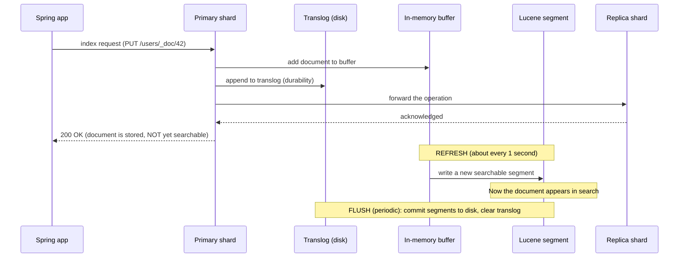

Key ideas:

- **Refresh** makes new documents searchable. The default interval is 1 second, which is the "near real-time" delay. (Shards that have received no search for a while skip scheduled refreshes until the next search arrives.)
- **Translog** protects data that is not yet committed to disk.
- **Segments are immutable.** An update is really "mark the old version deleted and write a new version." A delete only marks a document; **segment merges** physically remove it later.
- **`save()` replaces the whole document.** Partial changes need the update API.
- **Optimistic concurrency:** Elasticsearch tracks `_seq_no` and `_primary_term`, so conflicting writes can be detected. There are no locks and no multi-document transactions.

### 5.5 The search path: scatter and gather

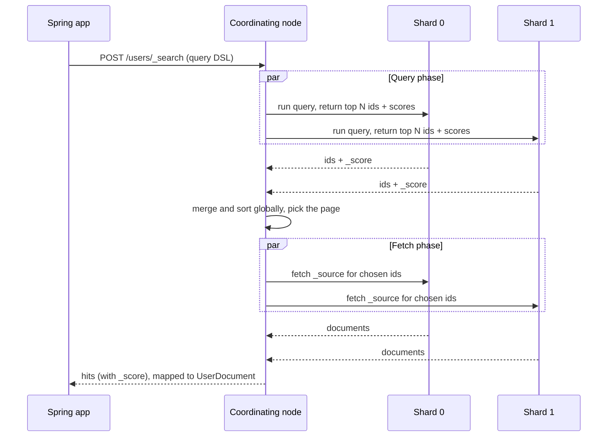

### 5.6 Relevance scoring

Results come back ordered by `_score`, calculated with **BM25** by default. Roughly:

- A term that appears **more often** in a document raises the score.
- A term that is **rare across all documents** counts for more than a common one.
- Matches in **shorter fields** count for more than in very long ones.
- You can add **boosts** (`firstName^2` weights that field double), allow **fuzziness** (typos such as "jhon" matching "john"), and use **More Like This** (`searchSimilar`) to find documents resembling a given one.

SQL has no built-in equivalent of ranked relevance.

---

## 6. Mapping a class: `@Entity` vs `@Document`

**JPA** (table, columns, relations):

```java
@Entity
@Table(name = "users")
public class User {
    @Id
    @GeneratedValue(strategy = GenerationType.IDENTITY)
    private Long id;

    @Column(nullable = false)
    private String firstName;

    private String lastName;
    private String headline;
    private String location;

    @OneToMany(mappedBy = "user")
    private List<Connection> connections;   // relations and joins live here
}
```

**Elasticsearch** (index, analyzed fields, no relations):

```java
@Document(indexName = "users")
public class UserDocument {
    @Id
    private String id;                       // usually the same value as the SQL id

    @Field(type = FieldType.Text, analyzer = "standard")
    private String firstName;

    @Field(type = FieldType.Text)
    private String lastName;

    @Field(type = FieldType.Text)
    private String headline;

    @Field(type = FieldType.Keyword)         // exact match, filters, sorting
    private String location;
}
```

Design differences:

- Elasticsearch documents are **denormalized**: store everything search needs in one document instead of joining at query time.
- Keep **only searchable and displayable fields**. The full record stays in SQL.
- Using the SQL primary key (as a string) for the document ID makes updates idempotent: the same event always overwrites the same document.

---

## 7. Writing queries

### 7.1 Derived methods (both stores)

```java
List<User> findByLastName(String lastName);
```

- **JPA:** `select u from User u where u.lastName = ?1`, then SQL.
- **Elasticsearch:** a query built from the method name (a text field is matched on analyzed terms).

### 7.2 `@Query` is a different language in each

**JPA, using JPQL** (SQL-like, written against entities):

```java
@Query("select u from User u where lower(u.firstName) like lower(concat('%', :q, '%'))")
List<User> searchByName(@Param("q") String q);
```

**Elasticsearch, using the Query DSL** (JSON):

```java
@Query("""
{
  "multi_match": {
    "query": "?0",
    "fields": ["firstName^2", "lastName^2", "headline", "location"],
    "fuzziness": "AUTO"
  }
}
""")
Page<UserDocument> search(String text, Pageable pageable);
```

What each one does:

| | JPQL `LIKE '%q%'` | Elasticsearch `multi_match` |
|---|---|---|
| Matching | Substring scan, often a full table scan | Looks terms up in the inverted index |
| Typos | No | Yes (`fuzziness`) |
| Several fields | You write `OR` for each | One query over a list of fields |
| Ordering | You define `ORDER BY` | Ranked by `_score` automatically |
| Weighting | Not possible | Per-field boosts (`^2`) |

### 7.3 Combining filters and search with `bool`

```json
{
  "bool": {
    "must":   [ { "multi_match": { "query": "java", "fields": ["headline", "firstName"] } } ],
    "filter": [ { "term": { "location": "Colombo" } } ]
  }
}
```

- `must` affects the score.
- `filter` only includes or excludes (not scored, and cached), so it is faster. Use it for exact conditions on `Keyword` fields.

---

## 8. Consistency, transactions and refresh

| | JPA / SQL | Elasticsearch |
|---|---|---|
| Multi-record transactions | Yes (`@Transactional`, commit/rollback) | No. Each document operation is atomic on its own only |
| Read after write | Immediate | A search sees a change only after the next refresh (about 1 second). Get-by-ID is real-time |
| Constraints | Foreign keys, unique, not null | None. Uniqueness is only by document ID |
| Concurrency | Locks and MVCC, `@Version` | Optimistic (`_seq_no`, `_primary_term`) |
| Joins | Native | Not supported (denormalize or nest) |

**Making a write visible immediately** (for example in a test, or "save then show the result"): Spring Data Elasticsearch supports a `RefreshPolicy` (for example `IMMEDIATE` or `WAIT_UNTIL`). Forcing a refresh on every write is expensive at scale, so use it sparingly and prefer waiting for the normal refresh in production.

---

## 9. Using both: the sync architecture

The usual pattern keeps SQL as the truth and updates Elasticsearch asynchronously from events.

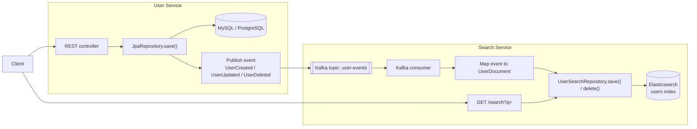

### 9.1 One update, end to end

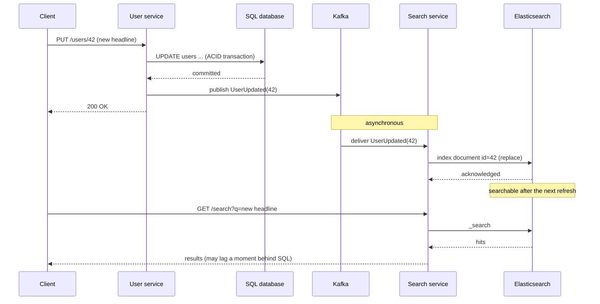

Total delay between the SQL commit and the search result is the Kafka delivery time, plus consumer processing, plus the refresh interval. It is usually a second or two, but it is **eventual consistency**, not instant.

### 9.2 Reading results

Search results usually return the fields stored in the index (names, headline, location). For the **full, authoritative record**, take the IDs from the search results and load them from SQL (or the user service) by primary key.

---

## 10. Failure modes and how to handle them

| Problem | What happens | How to handle it |
|---|---|---|
| **Dual write** (save to SQL, then call Elasticsearch directly) | If the second step fails, the two stores disagree | Publish an event instead. Use the **transactional outbox** pattern: write the event row in the same SQL transaction, and a relay publishes it |
| **Duplicate events** | The same event is processed twice | Use the SQL id as the document id, so a replay overwrites with identical data (idempotent) |
| **Out-of-order events** | An old update overwrites a newer one | Include a version or `updatedAt` in the event and ignore stale ones, or use Elasticsearch external versioning |
| **Consumer down or Elasticsearch down** | The index falls behind | Kafka keeps the events. The consumer catches up on restart. Use retries and a dead-letter topic |
| **Index damaged or mapping changed** | Data missing or wrongly analyzed | Rebuild: create a new index, bulk-load from SQL, and switch an **alias** to it |
| **Deletes** | Deleted users still show up in search | Publish `UserDeleted` and call `deleteById` on the search repository |
| **Stale search results** | A user edits a profile and does not see it yet | Accept a short delay, or read the latest record from SQL for the user's own profile |

Since the index is a copy, it can always be rebuilt from SQL. Treat it as disposable.

---

## 11. When to use which

Use the **JPA repository** when you need:
- Correct, durable storage of core data
- Transactions across several records or tables
- Relations, joins, constraints, reporting by exact values
- Reads that must reflect the latest write

Use the **Elasticsearch repository** when you need:
- Search across several text fields with ranking
- Typo tolerance, autocomplete, "similar items"
- Fast filtering and aggregations (facets) over large text-heavy data
- A read model that can lag slightly and be rebuilt

Use **both** when the app has a system of record plus a search feature, which is the normal case for a user directory like `UserSearchRepository`.

Do **not** use Elasticsearch as your only database for data you cannot afford to lose or must keep strictly consistent.

---

## 12. Common pitfalls

1. **Treating Elasticsearch as the source of truth.** It has no transactions or constraints. Keep the truth in SQL.
2. **Searching a `Keyword` field with free text, or sorting on a `Text` field.** `Text` is analyzed (split into terms) and is not sortable. Use a `Keyword` subfield for sorting and exact matching.
3. **Expecting joins.** Denormalize the data you need into the document.
4. **Deep pagination.** `from + size` is limited (10,000 results by default). Use `search_after` for deep paging.
5. **Expecting immediate visibility.** Searches lag by about the refresh interval. Don't write tests that save and search instantly without a refresh policy.
6. **Using `save()` for partial updates.** It replaces the whole document. Send the complete document, or use the update API.
7. **Letting mappings grow freely.** Dynamic mapping can create many fields and wrong types. Declare your mappings.
8. **Changing a mapping in place.** Field types cannot be changed on an existing index. Create a new index and reindex.
9. **Mixing up the ID types.** SQL often uses `Long`, while `ElasticsearchRepository<UserDocument, String>` uses `String`. Convert consistently.
10. **Forcing refresh on every write.** It hurts indexing throughput. Use it only where required.

---

## 13. Glossary

| Term | Meaning |
|---|---|
| **ACID** | Atomicity, Consistency, Isolation, Durability: the guarantees of a relational transaction |
| **Analyzer** | Character filters, a tokenizer and token filters that turn text into index terms |
| **BM25** | The default relevance scoring formula in Elasticsearch |
| **Denormalization** | Storing duplicated or combined data in one record to avoid joins |
| **Document** | One JSON record in Elasticsearch |
| **Dirty checking** | Hibernate detecting changed entity fields and issuing an `UPDATE` at flush |
| **Eventual consistency** | Different stores agree after a short delay, not instantly |
| **Fuzziness** | Matching terms within a small edit distance, to tolerate typos |
| **Index (Elasticsearch)** | A named collection of documents, split into shards |
| **Inverted index** | A map from each term to the documents that contain it |
| **JPQL** | Query language for JPA, written against entities rather than tables |
| **Lucene** | The search library inside each Elasticsearch shard |
| **MVCC** | Multi-version concurrency control, used by databases for isolation |
| **Outbox pattern** | Saving an event in the same SQL transaction as the data, then publishing it reliably |
| **Persistence context** | Hibernate's per-transaction cache of managed entities |
| **Query DSL** | Elasticsearch's JSON-based query language |
| **Refresh** | Making recent writes searchable (default interval about 1 second) |
| **Replica** | A copy of a shard for failover and read capacity |
| **Segment** | An immutable Lucene file set holding part of a shard's data |
| **Shard** | A slice of an index; each shard is a Lucene index |
| **Translog** | Transaction log that protects not-yet-committed writes in Elasticsearch |

---

### One-paragraph summary

`JpaRepository` talks to a relational database through Hibernate's stateful session: changes are tracked, flushed as SQL inside an ACID transaction, and are visible immediately. `ElasticsearchRepository` sends stateless JSON requests over HTTP to a cluster of Lucene shards: documents are analyzed into an inverted index, become searchable after a refresh, and are ranked by relevance. The sound design is SQL as the system of record, Elasticsearch as a rebuildable search copy, and Kafka events (ideally through an outbox) keeping them in sync.