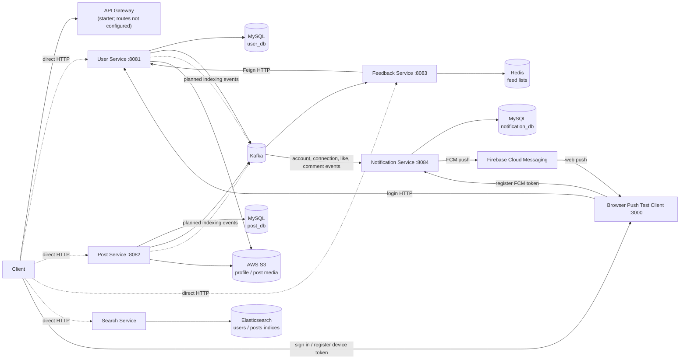

# LinkedIn System

A Java/Spring Boot microservices project that models selected LinkedIn-style features: accounts and profiles, professional connections, posts and engagement, a Redis-backed activity feed, and Elasticsearch search. Services are independently built Maven applications and communicate through HTTP, Kafka, and shared infrastructure.

> **Project status:** this repository is an in-progress implementation, not a production-ready LinkedIn replacement. The sections below describe the code and configuration currently present. Known integration gaps are listed under [Implementation status and limitations](#implementation-status-and-limitations).

## Contents

- [Architecture](#architecture)
- [Technology stack](#technology-stack)
- [Services](#services)
- [Data and event flows](#data-and-event-flows)
- [HTTP API](#http-api)
- [Run locally](#run-locally)
- [Configuration](#configuration)
- [Build and test](#build-and-test)
- [Implementation status and limitations](#implementation-status-and-limitations)

## Architecture



`docker-compose.yml` runs the local infrastructure only: MySQL, Redis, Elasticsearch, and a single-node Kafka broker. The Spring applications are run separately. The API Gateway currently has an application bootstrap but no implemented routing. Notification Service consumes Kafka events, looks up registered device tokens in MySQL, and sends pushes through Firebase Cloud Messaging. The local browser test client signs in through User Service and registers its browser token with Notification Service.

## Technology stack

| Area | Technology |
|---|---|
| Language/runtime | Java 17 |
| Application framework | Spring Boot 4.1.2 |
| Service APIs | Spring MVC / REST |
| Relational persistence | Spring Data JPA, Hibernate, MySQL 8 |
| Search | Spring Data Elasticsearch, Elasticsearch 8.11 |
| Messaging | Spring Kafka, Kafka in KRaft mode |
| Feed storage | Spring Data Redis, Redis lists |
| Media storage | AWS SDK for Java v2, Amazon S3 |
| Authentication primitives | JJWT 0.13 and BCrypt password hashing |
| Build | One Maven project per service; each includes a Maven Wrapper |

Spring Cloud OpenFeign is used by the Feedback Service to call the User Service. The API Gateway and Feedback Service declare Spring Cloud dependencies.

## Services

| Service | Default port | Responsibility and storage |
|---|---:|---|
| `user-service` | 8081 | Registration/login, profiles, profile images, and connection requests. MySQL database `user_db`; publishes user and connection events to Kafka. |
| `post-service` | 8082 | Create/read/delete posts, likes, and comments. MySQL database `post_db`; stores media in S3 and publishes post events to Kafka. |
| `feedback-service` | 8083 | Reads post-created events, looks up the author’s connections through User Service, and stores feed post IDs in Redis lists. |
| `search-service` | 8080 unless changed | REST search endpoints and Elasticsearch repositories for `users` and `posts` indices. Kafka event indexing is not yet implemented. |
| `api-gateway` | 8080 unless changed | Spring Cloud Gateway application scaffold. No routes or gateway-specific configuration are currently present. |
| `notification-service` | 8084 | Registers device tokens in its MySQL `notification_db` and sends registration, login, connection, like, and comment events as Firebase Cloud Messaging pushes. |

The default port for services without an explicit `server.port` is Spring Boot’s 8080. Run only one such service on that port at a time, or configure a different port.

## Data and event flows

### Relational data

- User Service owns users, skills, and connections in `user_db`. User IDs and connection IDs are UUIDs. Passwords are BCrypt hashes, not plaintext.
- Post Service owns posts, likes, and comments in `post_db`. Posts reference their author by ID rather than a cross-service JPA relationship. Likes and comments also store IDs rather than relational references to User Service.
- Both relational services use `spring.jpa.hibernate.ddl-auto=update`; Hibernate creates/updates schema during development.

### Kafka events

The producers use JSON message values and string keys. Topics currently referenced by code include:

| Topic                  | Producer/event | Current consumer |
|------------------------|---|---|
| `user.created`         | User Service after registration | Notification Service (FCM welcome push) |
| `user.logged_in`       | User Service after successful login; includes `userId`, `email`, and `firstName` | Notification Service (FCM login push) |
| `profile.updated`      | User Service after profile update | None implemented |
| `connection.requested` | User Service after a connection request | Notification Service (FCM push) |
| `connection.accepted`  | User Service after acceptance | Notification Service (FCM push) |
| `connection.rejected`  | Declared by User Service | No consumer; current reject path publishes to `connection.requested` instead |
| `post.created`         | Post Service after creating a post | Feedback Service |
| `post.liked`           | Post Service after a like; includes `postId`, `userId`, and `authorId` | Notification Service (FCM push) |
| `comment.created`      | Post Service after creating a comment; includes `commentId`, `postId`, `authorId`, `postAuthorId`, and `content` | Notification Service (FCM push) |

Kafka auto topic creation is enabled in the local Compose broker. For other Kafka installations, create the required topics or enable an equivalent broker policy.

### Feed and search

- Feed entries are stored as Redis lists using the key `feed:{userId}`. New post IDs are pushed to the head and the list is trimmed to the configured maximum.
- Feed reads use zero-based `page` and `size` parameters and return post IDs, not expanded post objects.
- Elasticsearch documents are defined for the `users` and `posts` indices. Repository queries include a multi-field user search and fuzzy post-content search.
- Although user/post events and index document types exist, a Kafka-to-Elasticsearch indexing consumer is not currently implemented.

### Media

User profile/cover images and post media are uploaded to S3. The relational entities store object keys or URLs. Local development therefore needs valid AWS credentials and an existing bucket for upload operations; there is no local S3 emulator configured in Compose.

## HTTP API

These are the controller routes currently present in the services. The Gateway does not yet proxy them, so use the service base URLs directly.

### User Service — `http://localhost:8081`

| Method | Path | Purpose |
|---|---|---|
| `POST` | `/api/v1/auth/register` | Register a user; returns access and refresh tokens and user details. |
| `POST` | `/api/v1/auth/login` | Authenticate with email/password. |
| `GET` | `/api/v1/user/{userId}` | Read a profile; requires `X-User-Id` header. |
| `PATCH` | `/api/v1/user/{userId}` | Update profile; requires matching `X-User-Id`. |
| `POST` | `/api/v1/user/{targetUserId}/connect` | Send a connection request; requires `X-User-Id`. |
| `POST` | `/api/v1/user/connection/{connectionId}/accept` | Accept a request; requires `X-User-Id`. |
| `POST` | `/api/v1/user/connection/{connectionId}/reject` | Reject a request; requires `X-User-Id`. |
| `GET` | `/api/v1/user/{userId}/connections` | Return connected profiles for a user. |
| `POST` | `/api/v1/user/{userId}/profile-photo` | Upload multipart field `file`; requires matching `X-User-Id`. |
| `POST` | `/api/v1/user/{userId}/cover-photo` | Upload multipart field `file`; requires matching `X-User-Id`. |

Registration JSON fields include `email`, `password`, `firstName`, and `lastName`; `headline` and `location` are optional. Email and required fields are validated, and the password must contain at least six characters.

### Post Service — `http://localhost:8082`

| Method | Path | Purpose |
|---|---|---|
| `POST` | `/api/v1/posts` | Create a post with request parameters `authorId`, `content`, and optional multipart `mediaUrl`. |
| `GET` | `/api/v1/posts/user/{authorId}` | List posts by author. |
| `GET` | `/api/v1/posts/{postId}` | Read one post. |
| `POST` | `/api/v1/posts/{postId}/like?userId=...` | Toggle a like for a user. |
| `GET` | `/api/v1/posts/liked?userId=...` | List posts liked by a user. |
| `POST` | `/api/v1/posts/{postId}/comment` | Add a comment using `authorId` and `content` request parameters. |
| `GET` | `/api/v1/posts/{postId}/comment` | Get paged comments; supports Spring `page`, `size`, and sorting parameters. |
| `DELETE` | `/api/v1/posts/{postId}?userId=...` | Delete a post if the supplied user ID is the author. |

### Feedback Service — `http://localhost:8083`

| Method | Path | Purpose |
|---|---|---|
| `GET` | `/api/v1/feed/{userId}?page=0&size=10` | Read a page of post IDs from the user’s Redis feed. |
| `DELETE` | `/api/v1/feed/{userId}/cache` | Clear the user’s cached feed. |

### Search Service — `http://localhost:8080` by default

| Method | Path | Purpose |
|---|---|---|
| `GET` | `/api/v1/search/people?query=...` | Search people by name, headline, or location. |
| `GET` | `/api/v1/search/skills?skill=...` | Search people by skill. |

Post search logic exists in the service/repository, but its controller method currently has no request mapping, so it is not exposed as an HTTP route.

### Notification Service — `http://localhost:8084`

| Method | Path | Purpose |
|---|---|---|
| `POST` | `/api/v1/notifications/devices/{userId}` | Register or update a device’s FCM registration token. JSON body: `{"token":"..."}`. |
| `DELETE` | `/api/v1/notifications/devices/{userId}` | Unregister a device token using the same JSON body. |

These token-registration routes do not authenticate the supplied `userId`; expose them only behind a trusted authenticated boundary until user identity is verified.

### Browser push test client — `http://127.0.0.1:3000`

The demo client in `notification-service/web-push-test` signs in through User Service, requests browser notification permission, gets an FCM token, and registers it with Notification Service. The browser permission prompt still requires an explicit user action. On later successful logins, User Service publishes `user.logged_in`, which Notification Service turns into a push to registered devices.

## Run locally

### Prerequisites

- JDK 17
- Docker Engine with Docker Compose
- AWS credentials and an S3 bucket if testing media uploads

### 1. Start infrastructure

From the repository root:

```bash
docker compose up -d
docker compose ps
```

The Compose file publishes MySQL on `3306`, Kafka on `9092`, Redis on `6379`, and Elasticsearch on `9200`. MySQL is configured with the local root password `root`; do not reuse this development setting outside a local environment.

### 2. Configure service properties

User and Post Service import optional `.env` property files. Supply the values required by their `application.properties` without committing credentials. See [Configuration](#configuration). Ensure each service’s MySQL credentials match the local MySQL container.

Feedback Service requires `feed.max-size` to be set (for example, in its `application.properties` or as the `FEED_MAX_SIZE` environment variable). The checked-in configuration does not currently define it.

### 3. Start Spring services

Run each command from the repository root in a separate terminal:

```bash
./user-service/mvnw -f user-service/pom.xml spring-boot:run
./post-service/mvnw -f post-service/pom.xml spring-boot:run
./feedback-service/mvnw -f feedback-service/pom.xml spring-boot:run
./search-service/mvnw -f search-service/pom.xml spring-boot:run
./notification-service/mvnw -f notification-service/pom.xml spring-boot:run
```

The User, Post, Feedback, and Notification services use ports 8081, 8082, 8083, and 8084. Search Service uses the default 8080 unless configured otherwise. The API Gateway has no configured forwarding routes.

For push delivery, configure Firebase Admin credentials using Application Default Credentials (for local development, set `GOOGLE_APPLICATION_CREDENTIALS` to a Firebase service-account JSON file outside the repository). Optionally set `FIREBASE_PROJECT_ID`.

To register a browser for local push testing, start the Vite app in Notification Service (not a server from the repository root, which contains the ignored service-account file):

```bash
npm --prefix notification-service/web-push-test install
npm --prefix notification-service/web-push-test run dev
```

Open `http://127.0.0.1:3000`, enter an existing account’s email/password and the VAPID public key from Firebase Console → Project settings → Cloud Messaging → Web Push certificates, then click **Sign in and enable notifications**. After successful sign-in, the page uses the returned user ID to obtain and register the browser FCM token automatically; the token is not displayed. Vite proxies authentication to User Service on port `8081` and device registration to Notification Service on port `8085`. Update these proxy targets in `notification-service/web-push-test/vite.config.js` if you use different ports. Device registration should be completed at least once before expecting a login push; on a first-ever login/signup the browser token does not exist until after authentication.

### 4. Smoke check

With User Service running, register a development account:

```bash
curl -i http://localhost:8081/api/v1/auth/register \
  -H 'Content-Type: application/json' \
  -d '{
    "email": "developer@example.test",
    "password": "change-me-now",
    "firstName": "Dev",
    "lastName": "User"
  }'
```

For actuator health, the User and Post service configurations expose the `health` and `info` endpoints. For example, try `http://localhost:8081/actuator/health`.

## Configuration

Configuration is per service in `src/main/resources/application.properties`; there is no root-level parent Maven project or shared configuration server.

| Property / environment variable | Used by | Notes |
|---|---|---|
| `JWT_SECRET` | User Service | Base64-encoded signing secret used for access and refresh JWTs. Keep it secret and use a sufficiently strong random value. |
| `JWT_EXPIRATION` | User Service | Access-token lifetime in milliseconds. |
| `JWT_REFRESH_EXPIRATION` | User Service | Refresh-token lifetime in milliseconds. |
| `AWS_ACCESS_KEY` | User and Post Services | AWS access key. Prefer the AWS SDK credential provider chain or a local role/profile over hard-coded keys where possible. |
| `AWS_S3_SECRET_KEY` | User and Post Services | AWS secret access key. |
| `AWS_S3_REGION` | User and Post Services | S3 bucket region. |
| `AWS_BUCKET_NAME` | User and Post Services | Existing bucket used for profile and post media. |
| `user.service.url` | Feedback Service | User Service base URL; defaults to `http://localhost:8081`. |
| `feed.max-size` / `FEED_MAX_SIZE` | Feedback Service | Maximum number of post IDs retained in each Redis feed list; currently must be supplied. |
| `GOOGLE_APPLICATION_CREDENTIALS` | Notification Service | Path to Firebase service-account credentials; keep this file outside source control. |
| `FIREBASE_PROJECT_ID` | Notification Service | Optional Firebase project ID when it cannot be inferred from the credentials/environment. |
| `MYSQL_USERNAME`, `MYSQL_PASSWORD` | Notification Service | MySQL credentials; local defaults are `root` / `root` for the Compose database. |
| Firebase Web Push VAPID public key | Browser push test client | Required by the Firebase Web SDK to obtain a web push token; configure in Firebase Console and enter into the local test page. This is a public key, not the service-account private key. |
| `spring.kafka.bootstrap-servers` | Kafka-enabled services | Local default is `localhost:9092`. |
| `spring.data.redis.host`, `spring.data.redis.port` | Feedback Service | Local defaults are `localhost` and `6379`. |
| `spring.elasticsearch.*` | Search Service | Point to the Elasticsearch instance; the local Compose endpoint is `http://localhost:9200`. |

Do not put real credentials in source control. The `.env` files in this repository are not templates; verify that local secret files are ignored by Git and replace any exposed credentials.

## Build and test

Each service is an independent Maven build. To compile one service:

```bash
./user-service/mvnw -f user-service/pom.xml -DskipTests compile
```

To run that service’s test suite:

```bash
./user-service/mvnw -f user-service/pom.xml test
```

Replace `user-service` in the wrapper and POM path with `post-service`, `feedback-service`, `search-service`, `api-gateway`, or `notification-service` as needed. A passing compile does not require the external databases to be running; application startup and integration tests may.

## Implementation status and limitations

- The API Gateway has its dependency and application bootstrap, but no routes or JWT validation/filter configuration. Current controllers are reached directly.
- Notification Service sends Firebase Cloud Messaging pushes for user-created/logged-in, connection-requested/accepted, post-liked, and comment-created events. Device tokens must first be registered, and Firebase credentials must be configured. The local browser test client registers a token after login; first-login/signup events can occur before registration and therefore may have no device to receive them.
- Notification token registration currently trusts the supplied user ID. Secure the endpoint with authenticated identity before exposing it to untrusted clients.
- Search event indexing is not wired: `SearchEvenConsumer` is empty, and current user/post Kafka events are not consumed to populate Elasticsearch.
- Search’s post-search service/repository exist, but the controller method lacks an HTTP mapping.
- Feedback Service requires `feed.max-size`; no default is checked in. Feed entries contain post IDs, and the read API does not expand them into post data.
- The connection model stores requester/receiver direction. Verify that accepted connections are represented in both directions if the product expects mutually visible connection lists.
- Event handling and data writes are not coordinated with an outbox/transactional event pattern. Kafka delivery failures can leave database state and downstream projections out of sync.
- Connection rejection still publishes to `connection.requested` instead of `connection.rejected`; see [Kafka events](#kafka-events).
- User profile and post authorization currently relies in places on caller-supplied IDs/headers. Do not expose these services to untrusted clients until authentication and authorization are enforced at a trusted boundary.
- Local infrastructure disables Elasticsearch security and uses single-node Kafka/MySQL/Redis configurations. These are for development only.
